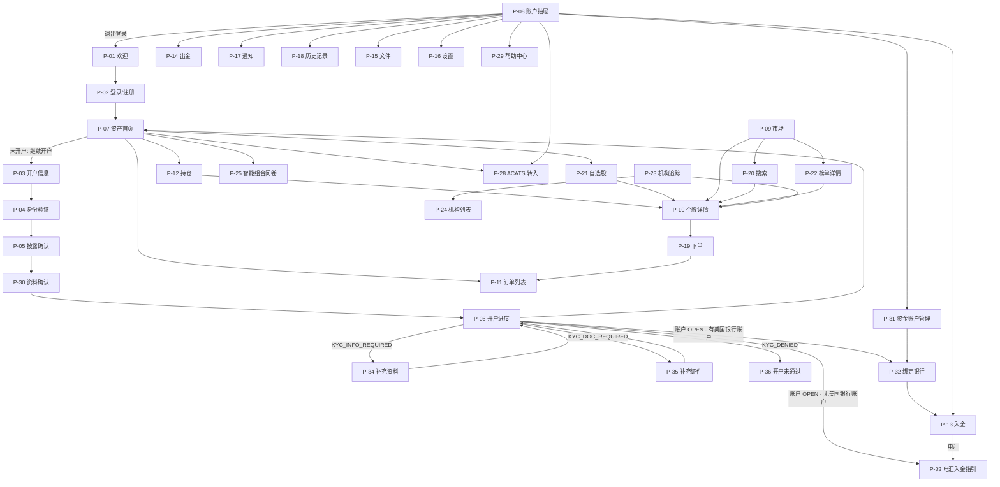

# 页面清单（pages.md）

> 依据：`design/reference/` 中 28 张截图（仅参考功能与结构）、`design/compliance-map.md`、
> `FinX_DriveWealth_Production_Signoff_24_Checklist`（DW 24 项）、`Compliance and AML Partner Application Onboarding Checklist`（PDF）。
>
> - 截图中的品牌名、吉祥物、图标、头像、真实人物姓名、营销文案均**不沿用**，下文统一使用中性的功能名称（如"AI 助手""智能组合"）。
> - 合规编号沿用 `compliance-map.md`：`1–24` 为 DW 上线清单，`PDF-1…6` 为 PDF 清单要点。状态一律"待确认"，本文件不代表已满足。
> - 状态：**第 5 版 · UI 已定稿（2026-11-19，定稿记录见 `design/ui-signoff.md`）**。视觉与文案两项定稿后变更已登记：FinX 主题（`design/theme.md`）；**开户与 KYC 模块（P-03–P-06、P-30、P-34–P-36）界面与用户输入一律英文**，App 其余模块中文，英文文案以原型为基准。页面结构与交互自本版冻结，后续改动走 ui-signoff.md 的变更记录。**已核实项**（有 DW 文档原文出处，标注"已核实"）可直接作为开发依据；**待 DW 确认项**（第 5.1 节 Q-DW-1 至 Q-DW-8）按规划值实现并留配置开关，其中 Q-DW-1、Q-DW-2 是沙盒接入前置条件。接口与后端方案见 `design/api-spec.md`、`design/backend-design.md`；产品需求见 `design/prd.md`。

---

## 0. 编号说明与变更

`compliance-map.md` 里的编号是临时的，而且 **P-10 同时被"个股详情"和"下单"占用**。本文件按以下原则对齐：

- 保留 compliance-map 已用的编号（P-03…P-18）不变，尽量少改动。
- 填补未用编号：P-01 欢迎、P-02 登录/注册、P-06 开户提交结果。
- **P-10 只代表"个股详情"**；"下单"另编为 **P-19**。因此清单 **10、12** 的主页面从 P-10 改为 P-19。
- 截图里有、compliance-map 未列的页面，编为 P-20 起。
- 子页面用字母后缀（如 P-03a）。
- **全局版式规则（第 4 版补充）**：页面内**不允许横向滚动**。筛选按钮放不下时换行（如 2 × 2），卡片列表用网格，表格只保留能在 390px 宽度内放下的列；不使用 `overflow-x` 横滑容器。

---

## 1. 页面总览

| 编号 | 名称 | 所属模块 | 主要合规编号 | 来源 |
|---|---|---|---|---|
| P-01 | 欢迎页 | 启动 | — | 截图 |
| P-02 | 登录 / 注册 | 启动 | — | 推断 |
| P-03 | 开户信息填写（含子步骤） | 开户 | 1, 2, 3, 4, 5, 6, PDF-1, PDF-2 | 截图 + 合规 |
| P-04 | 证件上传（开户流程中，仅非美国纳税人） | 开户 | 3 | 截图 + 合规 + DW |
| P-05 | 披露确认 | 开户 | 8, PDF-4 | 合规 + DW |
| P-06 | 开户进度（DW 用户创建 → KYC → 账户开立） | 开户 | 7 | 截图 + DW |
| P-07 | 资产首页（Tab 1） | 资产 | 9, 16 | 截图 |
| P-08 | 账户抽屉 / 账户切换 | 账户 | PDF-6 | 截图 |
| P-09 | 市场（Tab 2） | 行情 | 13, PDF-5 | 截图 |
| P-10 | 个股详情 | 行情 | 13, 14, PDF-5 | 推断 + 合规 |
| P-11 | 订单列表 | 交易 | 9, 11 | 合规 |
| P-12 | 持仓 | 资产 | 10, 16 | 截图 |
| P-13 | 入金 | 资金 | 20, PDF-3 | 截图 |
| P-14 | 出金 | 资金 | PDF-3 | 截图（入口） |
| P-15 | 文件 | 账户 | 17 | 截图（入口） |
| P-16 | 设置与个人资料（含关户） | 账户 | 22, 24 | 截图（入口） |
| P-17 | 通知与提示 | 账户 | 15 | 截图（入口） |
| P-18 | 历史记录 | 账户 | 16, 18 | 截图（入口） |
| P-19 | 下单（含确认页） | 交易 | 10, 12, 13, 15 | 合规 |
| P-20 | 搜索 | 行情 | 23 | 截图（入口） |
| P-21 | 自选股 | 行情 | 23 | 截图 |
| P-22 | 榜单详情 | 行情 | 13, 23 | 截图 |
| P-23 | 机构持仓追踪（Tab 3） | 发现 | 23 | 截图 |
| P-24 | 机构 / 投资人列表 | 发现 | — | 截图 |
| P-25 | 智能组合问卷（首期不做，待合规评估） | 发现 | 6（需评估） | 截图 |
| P-26 | AI 助手（Tab 4；首期不做，待合规评估） | 发现 | 6（需评估） | 截图 |
| P-27 | 奖励中心（Tab 5，即将推出） | 激励 | — | 截图 |
| P-28 | 从其他券商转入（ACATS） | 资金 | — | 截图 |
| P-29 | 帮助中心 | 账户 | — | 截图（入口） |
| P-30 | 开户资料确认（提交前汇总） | 开户 | 1–6, PDF-1, PDF-2 | DW |
| P-31 | 资金账户管理（ACH 银行账户） | 资金 | PDF-3 | DW |
| P-32 | 绑定银行账户（Plaid，美国用户） | 资金 | PDF-3 | DW |
| P-33 | 电汇入金指引 | 资金 | 20, PDF-3 | DW |
| P-34 | 补充开户资料（KYC_INFO_REQUIRED） | 开户 | 1–4, 24, PDF-1 | 第 3 版 |
| P-35 | 补充身份证件（KYC_DOC_REQUIRED） | 开户 | 3 | 第 3 版 |
| P-36 | 开户未通过（KYC_DENIED） | 开户 | 7 | 第 3 版 |
| S-01 | 全局状态页：加载中 / 会话过期 / 空状态 / 错误 / 账户受限 | 通用 | — | 截图 + DW |

> 第 2 版（2026-11-19）：补充 DW 的 KYC 状态处理、交易账户创建与资金账户（银行绑定、电汇）流程，新增 P-30 – P-33，修改 P-03/04/05/06/13/14/16。依据 `FinXStocks/DW-ONBOARDING.md`（DW OpenAPI 与官方文档调研），详见第 3.1 节。
>
> 第 3 版（2026-11-19）：按你的回复——① 开户资料由 App 提交到我方后端、再由后端提交 DW，核验由 DW 执行；② 资金完全按 DW 支持的方式走：ACH（Plaid 绑定本人美国银行账户）与电汇，不接入 DW 以外的支付渠道（PayPal 已取消）；③ KYC 未通过和需要补齐的页面重新设计，新增 P-34 补充资料、P-35 补充证件、P-36 开户未通过。详见第 3.2 节。
>
> 第 4 版（2026-11-19）：① P-02 增加 Google / Apple 登录，App 登录账户与 DW User 分开；② 首期账户固定为 `LIVE` / `CASH` / `SELF`，顾问管理统一称 `RIA_MANAGED`（待 DW 确认）；③ 按 DW 文档校对开户必填字段，补充 `COMPLIANCE_AML_INFO.fundingSources`；④ P-25、P-26 首期不做，待合规评估（页面规格保留）。

无对应页面、需文档或流程支撑的合规项：**7、19、21、23（后端主清单）**，见第 4 节。

---

## 2. 导航结构

底部 Tab（5 个）：**资产 P-07 / 市场 P-09 / 机构追踪 P-23 / AI 助手 P-26 / 奖励 P-27**。
右上角头像 → **账户抽屉 P-08**（所有 Tab 共用）。



---

## 3. 页面详情

### P-01 欢迎页
- **用途**：首次启动入口，引导注册或登录。
- **主要组件**：产品标识区（自有品牌，不沿用截图）、一句话说明、主按钮"注册"、次按钮"登录"。
- **跳转**：注册 / 登录 → P-02。已登录用户直接进入 P-07。
- **数据字段**：`isLoggedIn`、`appVersion`。
- **合规编号**：—

### P-02 登录 / 注册
- **用途**：App 登录账户的注册与登录。App 登录账户与 DW User 是两套身份，分开管理，通过 `applicationId` 关联。
- **登录方式**：
  - 主入口：邮箱 + 验证码（默认）。
  - 第三方：Google、Apple。提供 Google 登录时，必须同时提供 Sign in with Apple。
- **主要组件**：邮箱输入、获取验证码 / 验证码输入、"使用 Google 登录""通过 Apple 登录"按钮（按两家的官方按钮规范）、平台服务条款与隐私政策勾选（平台自有条款，不与 DW 披露混放）、提交按钮、错误提示（验证码错误、第三方授权取消或失败）。
- **跳转**：成功 → P-07；返回 → P-01；第三方授权取消或失败 → 留在 P-02 并提示。
- **数据字段**：`email`、`otpCode`、`loginProvider`（EMAIL / GOOGLE / APPLE）、`providerUserId`、`emailIsRelay`（Apple 返回中转邮箱时为 true）、`termsAccepted`、`termsVersion`、`sessionToken`、`applicationId`。
- **账户关系**：
  - App 登录账户（我方）与 DW User 分开。DW User 在 P-30 提交时由我方后端调用 `POST /users` 创建，返回的 `userID` 保存在我方后端，与 App 账户通过 `applicationId` 关联。
  - DW 文档中 `POST /users` 的顶层必填字段为 `userType`、`username`、`password`、`documents`（已核实 creating-a-user）；文档示例由客户端提供 username / password，未说明能否由 DW 生成。规划为我方后端生成和保管，不向用户展示，也不复用 App 登录凭据（待 Q-DW-4 书面确认）。
- **注意**：Apple 登录可能返回中转邮箱（`emailIsRelay=true`）。P-03b 增加"联系邮箱"字段，作为 DW `BASIC_INFO.emailAddress`；DW 能否接受中转邮箱待 DW 确认。
- **合规编号**：—（平台条款需与 P-05 的 DW 披露区分，参见 PDF-4）

### P-03 开户信息填写
- **用途**：采集开立券商账户所需的 KYC 信息。可暂存，中途退出后能继续。
- **子步骤**：
  - **P-03a 开户引导**：所需材料（美国用户 SSN / 非美国用户护照）、预计用时、可中途保存、数据用途与加密说明、"继续申请"按钮。
  - **P-03b 基本身份**：法定名、法定姓（只允许标准 ASCII 字母，实时校验 → **1**）、出生日期（不满 18 岁拦截 → **4**）、国籍、税务居民国；**第 4 版新增"联系邮箱"**：默认取登录邮箱，Apple 中转邮箱（`emailIsRelay=true`）时要求填写真实邮箱，作为 DW `BASIC_INFO.emailAddress`（能否使用中转邮箱待 DW 确认）。
  - **P-03c 税号**：TIN 类型（SSN / ITIN / 外国 TIN / NIN）与号码，说明须为本人报税用的政府签发号码 → **3**。
  - **P-03d 地址**：实际居住地址（检测并拦截 P.O. Box → **2**），可另填邮寄地址（允许 P.O. Box，按 PDF-1）。
  - **P-03e 就业与财务**：就业状态，在职或自雇时必填雇主名称与**所属行业**（下拉），**职位**为下拉（选填）——Demo-1 变更，选项见 3.1.6；年收入、净资产等投资者画像字段（必填项见 3.1.2）→ **PDF-1**；**第 4 版新增"资金来源"**（多选，对应 DW `COMPLIANCE_AML_INFO.fundingSources`）；**2026-11-19 选项与 DW 取值一一对应**：Employment income（EMP）、Savings（SAVINGS）、Investment returns（INVESTMENT）、Gift / Inheritance（GIFT）、Retirement（RETIRE）、Family support（FAMILY）、Sale of assets（SALE）、Rental income（RENT），无 Other（ui-signoff 第 3 节登记）。
  - **P-03f 三项监管问题** → **5、PDF-2**：
    1. 本人或账户受益人是否受雇于注册经纪商、FINRA 或证券交易所？是 → 填写机构名称，并展示需向雇主报备的说明。
    2. 是否为政治公众人物（PEP）？页面内给出 PEP 定义。是 → 填写 PEP 姓名（必填）、相关国家、职务及任职年份、离任年份（可选）。
    3. 是否为上市公司董事、10% 以上股东或政策制定官员？是 → 填写公司名称和股票代码。
  - **P-03g 账户类型** → **6**：首期固定为 `accountType=LIVE`、`tradingType=CASH`、`accountManagementType=SELF`，只读展示"现金账户 · 自主交易"，用户不可选择。保证金（`MARGIN`）与顾问管理（`RIA_MANAGED`，原文件称 ADVISORY）在 DW 确认前不展示，或仅以"暂未开放"只读展示，不可选择（待 DW 确认）。DW 文档未给出这三个字段的完整组合矩阵，所有组合以 DW 沙盒测试结果为准（见 3.1.1 注）。 合作方配置中的 `riaID`、`riaProductID` 不在开户文档（creating-a-user、opening-accounts）中出现，**不写入首期 API 规格**。RIA_MANAGED 所需的是 DW 分配的 `riaUserID`（已核实，opening-accounts）。首期 SELF 账户不发送任何 RIA 字段（已核实：SELF 组合示例不含 riaUserID）；合作方配置中的两个字段是否仍需提供，待 Q-DW-7 确认。
- **主要组件**：顶部进度条、分步表单、字段级校验提示、"保存并稍后继续"、返回 / 关闭（关闭时确认是否保存）。
- **跳转**：P-07"继续开户"卡片 → P-03a → … → P-03g → P-04；会话失效 → S-01（会话过期）。
- **数据字段**：`applicationId`、`currentStep`、`firstName`、`lastName`、`dateOfBirth`、`contactEmail`、`citizenship`、`taxResidency`、`tinType`、`tin`、`residentialAddress{line1,line2,city,state,postalCode,country}`、`mailingAddress{…}`、`isPOBox`、`employmentStatus`、`employerName`、`industry`、`position`（Demo-1 新增；原 `occupation` 自由文本停用）、`fundingSources[]`、`annualIncomeRange`、`netWorthRange`、`investmentExperience`、`investmentObjective`、`riskTolerance`、`isAffiliatedBD`、`affiliatedFirmName`、`isPEP`、`pepName`、`pepCountry`、`pepRoles[]{role,startYear,endYear}`、`isControlPerson`、`controlCompanyName`、`controlCompanySymbol`、`accountType`（首期固定 LIVE）、`tradingType`（首期固定 CASH；MARGIN 待 DW 确认）、`accountManagementType`（首期固定 SELF；RIA_MANAGED 待 DW 确认）。
- **合规编号**：1, 2, 3, 4, 5, 6, PDF-1, PDF-2

### P-04 身份验证
- **用途**：完成身份核验。美国用户以 SSN 核验；非美国用户上传护照资料页或其他政府证件。
- **主要组件**：核验方式说明、证件类型选择、拍照 / 上传（正面、必要时背面）、自拍活体（视 KYC 供应商而定）、上传进度、重拍、隐私说明。
- **跳转**：P-03g → P-04 → P-05；核验失败 → 重试或联系客服 P-29。
- **数据字段**：`idType`（PASSPORT/DRIVER_LICENSE/NATIONAL_ID）、`idNumber`、`idIssuingCountry`、`idExpiryDate`、`idFrontImage`、`idBackImage`、`selfieImage`、`kycProvider`、`kycStatus`（PENDING/PASSED/FAILED/MANUAL_REVIEW）、`kycFailureReason`。
- **合规编号**：3（PDF-1 证件采集）

### P-05 披露确认
- **用途**：开户前展示并让用户确认 DW 披露与平台自有披露，两部分**分开呈现**。
- **主要组件**：
  - "DriveWealth 披露"区块：标题须明确标注为 DW 披露，附官方披露链接与逐项文档。
  - 平台自有披露区块（客户协议、隐私政策等），与上面视觉上分开。
  - 电子签署同意（美国用户使用 E-Sign Act of 2000 语言，可单独一条勾选）。
  - 每项单独勾选或"我已阅读并同意"、签名（输入姓名）、提交申请按钮（全部确认后才可点）。
- **跳转**：P-04 → P-05 → 提交 → P-06；点开文档 → 内置浏览器 / PDF 预览。
- **数据字段**：`disclosures[]{id,source(DW/PARTNER),title,url,version,acknowledged,acknowledgedAt}`、`eSignConsent`、`eSignConsentAt`、`signatureName`、`ipAddress`、`deviceId`。
- **合规编号**：8, PDF-4

### P-06 开户提交结果
- **用途**：告知申请已提交、账户尚未开通，给出申请参考号和审核预期。
- **主要组件**：状态插图（自绘，不沿用截图形象）、标题、说明、申请参考号卡片（可复制）、预计审核时长、"返回首页"按钮。补件 / 驳回时显示原因和下一步按钮。
- **跳转**：返回首页 → P-07（首页显示"审核中"）；需补件 → 对应的 P-03 子步骤或 P-04。
- **数据字段**：`applicationId`、`applicationRef`、`applicationStatus`（SUBMITTED/IN_REVIEW/APPROVED/REJECTED/ACTION_REQUIRED）、`submittedAt`、`estimatedReviewTime`、`actionRequiredItems[]`。
- **合规编号**：—

### P-07 资产首页（Tab 1）
- **用途**：资产总览，按账户状态展示不同内容。
- **页面状态**：
  1. **未登录交易账户**：提示卡 + "交易登录"按钮 + "先看行情"（→ P-09）/"模拟交易"（切到模拟账户）。
  2. **未开户 / 开户中**：资产卡显示占位符，并有"继续开户"卡片（→ P-03）或"审核中"状态（→ P-06）。
  3. **已开户（实盘或模拟）**：完整内容（见下）。
- **主要组件**：标题栏 + 头像（→ P-08）；总资产卡（总资产、可隐藏金额、购买力、今日盈亏金额与百分比、走势折线图）；时间区间切换（1 日 / 1 周 / 3 月 / 1 年 / 今年）；ACATS 转入推广卡（→ P-28）；待处理订单摘要（数量、列表、刷新，→ P-11）；持仓摘要（全部 / 股票 / ETF 环形图，→ P-12）；智能组合入口卡（→ P-25）；自选股模块（分组、编辑、排序、空状态"添加股票"，→ P-21 / P-20）；底部 Tab 栏。
- **跳转**：头像 → P-08；待处理订单 → P-11；持仓 → P-12；推广卡 → P-28；智能组合 → P-25；自选股条目 → P-10；添加股票 → P-20。
- **数据字段**：`accountMode`（LIVE/PAPER）、`accountStatus`、`totalEquity`、`buyingPower`、`cashBalance`、`dayPnL`、`dayPnLPct`、`equityHistory[]{t,value}`（按 `range`）、`pendingOrdersCount`、`pendingOrders[]`、`allocation{cash,stock,etf}`、`watchlistGroups[]{id,name,symbols[]}`、`hideBalances`。
- **合规编号**：16（余额与持仓概览）、9（待处理订单入口）

### P-08 账户抽屉 / 账户切换
- **用途**：从右侧滑出，用于切换实盘 / 模拟账户、显示账户号码，并集中放置资金、动态、管理类入口。
- **主要组件**：用户头像与邮箱；实盘 / 模拟分段切换；账户卡（**账户号码**、账户类型标签（首期固定显示"现金 · 自主"，对应 `LIVE` / `CASH` / `SELF`）、在线状态点、市值、购买力、现金、入金 / 转入快捷按钮；不可用时提示"交易账户暂不可用"）；资金分组（入金 / 出金 / 转入其他券商账户）；动态分组（通知 / 历史记录 / 文件）；管理分组（设置 / 帮助中心 / 退出登录）；版本号。
- **跳转**：入金 → P-13；出金 → P-14；转入 → P-28；通知 → P-17；历史记录 → P-18；文件 → P-15；设置 → P-16；帮助 → P-29；退出登录 → 二次确认 → P-01。
- **数据字段**：`userEmail`、`avatarUrl`、`accounts[]{accountId,accountNumber,mode,status,accountType,tradingType,accountManagementType,marketValue,buyingPower,cash}`、`activeAccountId`、`appVersion`、`unreadNotificationCount`。
- **合规编号**：PDF-6（账户号码须在 App 内可见，不能只出现在对账单上）

### P-09 市场（Tab 2）
- **用途**：美股行情总览与发现入口。
- **主要组件**：标题 + 搜索图标（→ P-20）；市场切换（美股）；股票 / ETF 分段切换。
  - **股票**：指数 ETF 卡片（代码、最新价、涨跌幅）；涨跌分布柱状图（当日 / 近一月）；股东增减持摘要（增持最多 / 减持最多 / 最活跃，→ P-22）；股票榜单（涨幅榜等，→ P-22）。
  - **ETF**：今日热点主题气泡（主题名、代表 ETF、涨跌幅）；ETF 排行（分类筛选、名称 / 代码、最新价、涨跌幅、成交额，可排序）。
  - 行情数据来源与延时标识（实时 / 延时 15 分钟）。
- **跳转**：任一证券 → P-10；"更多" → P-22；搜索 → P-20。
- **数据字段**：`indexCards[]{symbol,last,changePct}`、`advanceDecline{buckets[],range}`、`insiderSummary{topBuy,topSell,mostActive}`、`rankings[]{type,items[]{symbol,name,last,changePct,turnover}}`、`etfThemes[]{theme,symbol,changePct}`、`etfCategories[]`、`quoteDelayStatus`、`dataTimestamp`。
- **合规编号**：13、PDF-5（列表页只展示最新价时，需确认 NBBO 在个股详情页完整展示）

### P-10 个股详情
- **用途**：单只证券的行情、图表和基本信息，交易入口。
- **主要组件**：代码 / 名称 / 交易所；最新价与涨跌；**Vendor Display Rule 报价区**（NBBO 买一价 / 量、卖一价 / 量、对应市场标识，综合最新成交价、成交量）；行情时间戳与延时标识；历史 K 线 / 分时图（1D/1W/1M/3M/1Y/5Y，**带缓存**）；关键指标（市值、市盈率、52 周高低等）；我的持仓（如有）；加自选；买入 / 卖出按钮；不可交易证券的提示。
- **跳转**：买入 / 卖出 → P-19；返回上一页；加自选 → P-21。
- **数据字段**：`symbol`、`name`、`exchange`、`instrumentId`、`isTradable`、`last`、`change`、`changePct`、`bidPrice`、`bidSize`、`bidExchange`、`askPrice`、`askSize`、`askExchange`、`lastSalePrice`、`lastSaleSize`、`lastSaleExchange`、`volume`、`quoteTimestamp`、`quoteLevel`（REALTIME/DELAYED）、`chartSeries[]{t,o,h,l,c,v}`、`chartRange`、`chartCachedAt`、`marketCap`、`peRatio`、`week52High`、`week52Low`、`position{qty,avgCost,marketValue,unrealizedPnL}`、`inWatchlist`。
- **合规编号**：13, 14, PDF-5

### P-11 订单列表
- **用途**：查看所有订单，取消待处理订单。
- **主要组件**：状态筛选（待处理 / 已成交 / 部分成交 / 已取消 / 已拒绝）；订单卡（代码、方向、类型、委托数量 / 金额、**已成交数量 / 剩余数量**、成交均价、状态标签、时间）；待处理订单"取消"按钮 + 二次确认；订单详情抽屉（成交明细、费用、拒绝 / 取消原因，如因公司行动被取消也在此说明）；下拉刷新。
- **跳转**：P-07 / P-19 → P-11；订单 → 订单详情；证券代码 → P-10。
- **数据字段**：`orders[]{orderId,symbol,side,orderType,timeInForce,qty,notional,limitPrice,stopPrice,filledQty,remainingQty,avgFillPrice,status,fees,commission,rejectReason,cancelReason,createdAt,updatedAt,fills[]{qty,price,time}}`、`cancelRequestStatus`。
- **合规编号**：9, 11（18：公司行动导致的取消原因展示）

### P-12 持仓
- **用途**：所有持仓的明细与盈亏。
- **主要组件**：市值与总持仓盈亏；全部 / 股票 / ETF 筛选；资产配置环形图（现金 / 股票 / ETF 及占比）；持仓列表（代码、名称、市值、数量、**成本**、持仓盈亏金额与百分比）；零碎股 / 极小剩余持仓提示（引导"全部卖出"）；搜索。
- **跳转**：持仓条目 → P-10；搜索 → P-20。
- **数据字段**：`marketValue`、`totalUnrealizedPnL`、`allocation{cash,stock,etf,pct}`、`positions[]{symbol,name,assetType,qty,avgCost,costBasis,lastPrice,marketValue,unrealizedPnL,unrealizedPnLPct,isDeMinimis}`。
- **合规编号**：16, 10（提示）

### P-13 入金
- **用途**：从已绑定的银行账户入金。
- **主要组件**：入金方式选择（银行转账 ACH，使用已关联且通过审核的银行账户）；银行账户选择 / 绑定新账户（显示可绑定数量上限）；金额输入（显示最低 / 最高限额）；**结算截止时间与到账时间说明**；退票（资金被退回）的后果与限制说明；仅限本人名下账户、不接受第三方入金的说明；确认页；结果页（流水号、预计到账日）。
- **跳转**：P-08 / P-07 → P-13 → 确认 → 结果 → P-18 或 P-07。
- **数据字段**：`fundingMethods[]`、`linkedBanks[]{bankId,name,mask,status,ownerName}`、`maxLinkedBanks`、`amount`、`currency`、`minDeposit`、`maxDeposit`、`dailyLimit`、`cutoffTime`、`estimatedSettlementDate`、`depositId`、`depositStatus`、`isThirdParty`。
- **第 4 版补充（资金时效，均待 DW 确认，依据见 3.1.5）**：页面不再写"下一个工作日可用于交易"，改为"结算后授予购买力，通常 4–5 个工作日（待 DW 确认）"；说明 ACH 入金到账后默认 30 天观察期内不可提现（可由 DW 配置调整，待 DW 确认），电汇入金不受观察期限制；入金类型只列文档示例值 `ACH`、`CASH_PROMOTION`（待复核原文），完整枚举待 DW 确认；提交截止时间为示例值（待 DW 确认）。
- **合规编号**：20, PDF-3

### P-14 出金
- **用途**：将可提现余额转到已绑定的本人银行账户。
- **主要组件**：可提现金额（与总现金、未结算资金分开显示）；收款银行选择；金额输入与限额；预计到账时间；费用；确认页；结果页。
- **跳转**：P-08 → P-14 → 确认 → 结果 → P-18。
- **数据字段**：`withdrawableCash`、`unsettledCash`、`linkedBanks[]`、`amount`、`minWithdrawal`、`maxWithdrawal`、`fee`、`estimatedArrival`、`withdrawalId`、`withdrawalStatus`。
- **第 4 版补充（均待 DW 确认，依据见 3.1.5）**：可提现金额 = DW 返回的可提现余额（`cashAvailableForWithdrawal`，出处 withdrawing-1 （待复核原文））；原型中模拟为"账户现金 − 未结算资金 − 待成交买单占用 − ACH 观察期内金额"，并单列"ACH 入金观察期内金额（30 天）"。说明"默认 30 天，可由 DW 配置调整（待 DW 确认）；电汇入金不受此限制"。ACH 出金手续费按 DW 文档为 $0.25；电汇出金在美东 17:00 前提交当日处理，收费按 DW 标准（均待 DW 确认）。新增数据字段 `achSeasoningHold`、`seasoningDays`。
- **合规编号**：PDF-3

### P-15 文件
- **用途**：查看和下载交易确认书、对账单、税务文件。
- **主要组件**：分类 Tab（交易确认书 / 账户对账单 / 税务文件）；按年份 / 月份筛选；文件列表（名称、日期、类型）；PDF 预览与分享 / 下载；空状态。
- **跳转**：P-08 → P-15 → 文件预览。
- **数据字段**：`documents[]{docId,type(TRADE_CONFIRM/STATEMENT/TAX),title,period,date,fileUrl,fileFormat}`、`filterYear`、`filterType`。
- **合规编号**：17

### P-16 设置与个人资料
- **用途**：账户设置、个人资料修改、关户。
- **子页面**：
  - **P-16a 个人资料**：查看和修改地址、邮箱、电话、就业信息。提交后显示"同步券商中 / 已同步"状态 → **24**。修改地址同样拦截 P.O. Box（→ 2）。
  - **P-16b 安全**：登录方式、生物识别、设备管理。
  - **P-16c 偏好**：语言、涨跌颜色、隐藏金额默认值、通知开关。
  - **P-16d 关闭账户**：先检查现金与持仓，**有余额或持仓时拦截**，引导出金 / 卖出 / 转出 → **22**；可以关户时二次确认。
- **跳转**：P-08 → P-16 → 各子页；关户被拦截 → P-14 / P-12 / P-28。
- **数据字段**：`profile{email,phone,residentialAddress,mailingAddress,employmentStatus,employerName}`、`profileSyncStatus`（PENDING/SYNCED/FAILED）、`lastSyncedAt`、`securitySettings`、`preferences{language,colorScheme,hideBalances,notifications}`、`closeEligibility{cash,positionsCount,pendingOrdersCount,eligible}`。
- **合规编号**：22, 24

### P-17 通知与提示
- **用途**：系统通知、交易提醒，以及**交易违规与限制告知**。
- **主要组件**：分类（交易 / 资金 / 账户 / 违规与限制 / 系统）；违规卡片（违规类型，如 Good Faith Violation、Free-riding、PDT；发生日期；当前限制；限制解除日期；说明链接）；已读 / 未读；推送跳转。
- **跳转**：P-08 → P-17；通知 → 对应页（订单 P-11、入金 P-13、文件 P-15 等）。
- **数据字段**：`notifications[]{id,category,title,body,createdAt,read,deepLink}`、`violations[]{type,occurredAt,restriction,restrictionUntil,count}`、`accountRestrictions[]`。
- **合规编号**：15

### P-18 历史记录
- **用途**：完整账户流水：交易、资金进出、分红、费用、公司行动。
- **主要组件**：类型筛选（交易 / 入金 / 出金 / 分红 / 费用 / 公司行动）；时间筛选；流水列表（类型、代码、数量、金额、日期、状态）；公司行动条目说明（如拆股导致数量变化、证券代码变更、相关订单被取消）；详情页。
- **跳转**：P-08 → P-18 → 详情；交易条目 → P-11 订单详情。
- **数据字段**：`transactions[]{txnId,type,symbol,qty,price,amount,fee,status,date,description}`、`corporateActions[]{type(SPLIT/REVERSE_SPLIT/SYMBOL_CHANGE/MERGER/DIVIDEND),symbol,exDate,ratio,qtyBefore,qtyAfter,affectedOrderIds[]}`。
- **合规编号**：16, 18

### P-19 下单（含确认页）
- **用途**：买入 / 卖出下单。
- **主要组件**：方向（买 / 卖）；订单类型（市价 / 限价 / 止损…，按首期支持范围）；数量或金额（支持零碎股时）；限价 / 止损价；有效期；实时 NBBO 简要报价；可用购买力 / 可卖数量；**预估佣金和费用**；预估总额；**极小剩余持仓提示**（卖出后剩余低于阈值时建议全部卖出 → 10）；违规风险预警（如可能触发 Good Faith Violation → 15）；确认页（订单要素汇总、费用、提交）；提交结果（→ P-11）。
- **跳转**：P-10 → P-19 → 确认 → 结果 → P-11 或返回 P-10。
- **数据字段**：`symbol`、`side`、`orderType`、`qty`、`notional`、`limitPrice`、`stopPrice`、`timeInForce`、`buyingPower`、`sellableQty`、`bid`、`ask`、`last`、`estimatedCommission`、`estimatedFees[]{name,amount}`、`estimatedTotal`、`deMinimisThreshold`、`residualQtyAfterOrder`、`violationWarning`、`orderId`、`submitStatus`。
- **合规编号**：12, 10, 13, 15（警示）

### P-20 搜索
- **用途**：按代码 / 名称搜索证券。
- **主要组件**：搜索框、最近搜索、热门搜索、结果列表（代码、名称、交易所、类型、加自选按钮）、无结果状态。
- **跳转**：结果 → P-10。
- **数据字段**：`query`、`results[]{instrumentId,symbol,name,exchange,assetType,isTradable}`、`recentSearches[]`。
- **合规编号**：23（结果只来自平台维护的证券主清单）

### P-21 自选股
- **用途**：管理自选股分组。
- **主要组件**：分组 Tab；列表（代码、名称、最新价、涨跌幅）；排序（涨跌幅等）；编辑模式（删除、拖拽排序、新建分组）；空状态"添加股票"。
- **跳转**：条目 → P-10；添加 → P-20。
- **数据字段**：`watchlistGroups[]{groupId,name,items[]{symbol,name,last,changePct,sortIndex}}`、`sortBy`。
- **合规编号**：23

### P-22 榜单详情
- **用途**：完整榜单（涨幅榜、ETF 排行、股东增减持）。
- **主要组件**：榜单类型切换；分类筛选；可排序表头；列表；数据时间。
- **跳转**：条目 → P-10。
- **数据字段**：`rankingType`、`category`、`sortField`、`sortOrder`、`items[]{symbol,name,last,changePct,turnover,insiderNetChange}`、`dataTimestamp`。
- **合规编号**：13, 23

### P-23 机构持仓追踪（Tab 3）
- **用途**：基于公开 13F 等披露数据，展示知名机构的持仓变动和个股机会。
- **主要组件**：顶部横幅（自有设计）；机构分组切换（热门 / 最近更新 / 更多）；**机构卡片 3 列 × 2 行网格**（机构名、年化收益标签，共 6 张）；个股机会表——筛选按钮**2 × 2 换行排列**（增持最多 / 逆势增持 / 持股最多 / 新进持股）；季度选择；表格只保留 3 列：代码（含 US 标签，最新价以小字放在代码下方）、增持占总股本、增 / 平 / 减家数；**数据来源与免责声明**（非投资建议）。整页不允许横向滚动。
- **跳转**：机构卡片 / "更多" → P-24；个股 → P-10。
- **数据字段**：`institutions[]{id,name,returnPct,updatedAt,avatar}`、`quarter`、`filterType`、`opportunities[]{symbol,market,holdingPctOfShares,increaseCount,unchangedCount,decreaseCount}`、`dataSource`、`disclaimer`。
- **合规编号**：—（建议补一条免责声明的合规确认；只展示主清单内证券 → 23）

### P-24 机构 / 投资人列表
- **用途**：全部机构的列表与排序。
- **主要组件**：表格（名称 / 公司、收益、资产增速、更新时间，可排序）；头像统一用字母占位（不使用真人照片）。
- **跳转**：返回 P-23；条目 → 机构详情（截图未提供，待定）。
- **数据字段**：`institutions[]{id,name,firmName,returnPct,aumGrowthPct,updatedAt}`、`sortField`。
- **合规编号**：—

### P-25 智能组合问卷（首期不做，待合规评估）
- **首期范围**：首期不做，待合规评估；以下页面规格保留，供后续评估使用。
- **用途**：用户回答约 10 道问卷题，系统按风险评分匹配一个组合，可一键加入。
- **主要组件**：介绍卡（三步：问卷 → 匹配 → 一键投资）；风格标签；问卷页（进度条、单选题）；结果页（组合风格、持仓与权重、理由说明）；"一键加入"按钮（→ P-19 批量下单确认）。
- **跳转**：P-07 → P-25 → 结果 → P-19。
- **数据字段**：`questions[]{id,text,options[]}`、`answers[]`、`riskScore`、`portfolioStyle`、`holdings[]{symbol,weight,rationale}`。
- **合规编号**：**6（需评估）**：给出个性化组合并一键执行，可能被视为顾问管理（`RIA_MANAGED`，待 DW 确认）服务，与"自主账户"定位冲突。上线前需合规确认。

### P-26 AI 助手（Tab 4；首期不做，待合规评估）
- **首期范围**：首期不做，待合规评估；以下页面规格保留，供后续评估使用。
- **用途**：AI 投资助手的预告页，收集"上线提醒"订阅。
- **主要组件**：标题与副标题、"即将推出"横幅（自有插画）、6 项能力卡片（持仓检查、持有或卖出分析、个股研究、风险提醒、量化信号、学习投资），每项带锁定状态，"上线提醒"按钮、积分（XP）徽章、头像。
- **跳转**：上线提醒 → 订阅成功提示；头像 → P-08。
- **数据字段**：`features[]{id,title,desc,locked}`、`notifySubscribed`、`xpBalance`。
- **合规编号**：6（需评估）：正式上线前需评估是否属于投资建议或顾问管理（`RIA_MANAGED`，待 DW 确认）。

### P-27 奖励中心（Tab 5，即将推出）
- **用途**：完成任务赚积分、兑换虚拟物品的预告页。
- **主要组件**：横幅、等级 Tab（等级 1–N，未解锁的带锁）、奖励物品网格（名称、所需积分、"即将推出"）、后续开放预告、"上线提醒"按钮、积分徽章。
- **跳转**：上线提醒 → 订阅成功；头像 → P-08。
- **数据字段**：`levels[]{level,locked}`、`rewards[]{id,name,xpCost,level,status}`、`xpBalance`、`notifySubscribed`。
- **合规编号**：—（如积分与入金或交易挂钩，需确认激励类合规要求）

### P-28 从其他券商转入（ACATS）
- **用途**：引导用户把其他券商的股票和现金转入，无需先卖出。
- **主要组件**：流程说明、转出券商选择 / 搜索、转出账户号码、全部 / 部分转入选择、持仓清单（部分转入时）、提交确认、进度状态。
- **跳转**：P-07 推广卡 / P-08 → P-28 → 结果 → P-18。
- **数据字段**：`contraBroker{name,dtcNumber}`、`contraAccountNumber`、`transferType`（FULL/PARTIAL）、`assets[]{symbol,qty}`、`transferId`、`transferStatus`。
- **合规编号**：—（建议核实与 PDF-3 资金控制相关的说明）

### P-29 帮助中心
- **用途**：常见问题、联系客服。
- **主要组件**：搜索、FAQ 分类、在线客服 / 邮件入口、法律文件链接（含 DW 披露入口）。
- **跳转**：P-08 → P-29；披露链接 → 文档预览。
- **数据字段**：`faqCategories[]`、`articles[]{id,title,body}`、`supportChannels[]`。
- **合规编号**：—

### S-01 全局状态页
- **用途**：所有流程共用的状态模板。
- **类型**：加载中（开户申请恢复中等）、会话过期 / 未登录（"返回 App"与"重试"）、网络错误、空状态、功能暂不可用（如交易账户不可用）。
- **数据字段**：`stateType`、`message`、`retryAction`、`fallbackRoute`。
- **合规编号**：—
- **第 2 版补充**：新增"账户受限"类型，对应 DW 账户状态 `OPEN_NO_NEW_TRADES`（仅可卖出）、`FROZEN`（冻结，不可交易）、`CLOSED`。受限时 P-07 顶部常驻提示条，P-10 / P-19 禁用相应交易按钮并说明原因。

---

## 3.1 DW 开户与资金账户（第 2 版补充）

> 依据 `FinXStocks/DW-ONBOARDING.md`（DW OpenAPI `InvestingAPI.yaml` 与 developer.drivewealth.com 调研）。接口名、字段名、状态枚举在 DW sandbox 实测前均为**待验证**；DW 无 Webhook，状态靠 SQS 事件或轮询，App 侧统一从我方后端读取。App 不直接调用 DW，也不接触 DW 凭据。

### 3.1.1 总体顺序

| 阶段 | DW 动作（后端） | App 页面 | 用户可见状态 |
|---|---|---|---|
| ① 采集资料 | — | P-03 → P-04 → P-05 → P-30 | 填写中（草稿可保存） |
| ② 创建 User | `POST /users`，首次提交 BASIC_INFO、IDENTIFICATION_INFO、PERSONAL_INFO、ADDRESS_INFO（已核实，creating-a-user）；其余文档 `PATCH /users/{userID}` 补充（已核实）；是否可一次提交全部，待 Q-DW-3 | P-30 提交 → P-06 | 资料已提交 |
| ③ KYC | 自动发起；以 `GET /users/{userID}/kyc-status` 返回的 `kyc.status.name` 为准，主要通过 SQS `kyc.created` / `kyc.updated` 事件获知，轮询仅用于对账（待 DW 确认） | P-06（各状态分支） | 审核中 / 需补资料 / 需补证件 / 人工复核 / 通过 / 拒绝 |
| ④ 创建 Account | KYC_APPROVED 后 `POST /accounts`，首期固定 `accountType=LIVE`、`tradingType=CASH`、`accountManagementType=SELF`（待 DW 确认） | P-06 | 账户开立中 → 已开通（显示账户号码） |
| ⑤ 资金账户 | ACH：`POST /back-office/bank-accounts`（银行账号、路由号、userID、昵称、账户类型，已核实 depositing-1）；绑定方式（直接录入或 Plaid）待 Q-DW-2；电汇：`GET /accounts/{id}/funding/deposit-instructions` | P-32 / P-33，管理在 P-31 | 已绑定银行 / 电汇信息 |
| ⑥ 入金 | ACH：`POST /back-office/funding/deposits`（`type=ACH`、`bankAccountID`、`accountNo`、`amount`、`currency`，已核实 depositing-1）；电汇：用户按 P-33 指引从本人银行汇款，DW 入账；事件 `deposits.created/updated` | P-13 / P-33 | 处理中 → 已到账 / 被退回 |
| ⑦ 出金 | `POST /funding/redemptions`（`type=ACH` 或 `WIRE`） | P-14 | 处理中 → 成功 / 失败 / 被拒 |

> 第 3 版：资料流向为 **App → 我方后端 → DW**，App 不直接调用 DW；身份核验由 DW 执行。资金只使用 DW 支持的 ACH 与电汇，我方不经手客户资金。

> 第 4 版 · 账户类型（参考 https://developer.drivewealth.com/apis/docs/opening-accounts ）：
> - 首期账户：`accountType=LIVE`、`tradingType=CASH`、`accountManagementType=SELF`。
> - 术语统一：原"ADVISORY / 顾问"改为 DW 的 `RIA_MANAGED`（待 DW 确认）。DW 文档示例中 `RIA_MANAGED` 需同时提供 DW 分配的 `riaUserID`；保证金账户需先提交 `MARGIN_DISCLOSURE`。两者在 DW 确认前不允许用户选择。
> - 合作方配置中的 `riaID`、`riaProductID` 不在开户文档（creating-a-user、opening-accounts）中出现，**不写入首期 API 规格**。RIA_MANAGED 所需的是 DW 分配的 `riaUserID`（已核实，opening-accounts）。首期 SELF 账户不发送任何 RIA 字段（已核实：SELF 组合示例不含 riaUserID）；合作方配置中的两个字段是否仍需提供，待 Q-DW-7 确认。
> - DW 文档未给出 `accountType` / `tradingType` / `accountManagementType` 的完整枚举组合矩阵，**所有组合以 DW 沙盒测试结果为准**。

### 3.1.2 P-03 字段补充（按 DW `documents` 类型；第 4 版按 DW 文档校对）

> 依据 DW 开发者文档原文逐条核对（2026-11-19 查阅）。DW 对每个 document 单独校验必填字段。**表中所有字段在 DW 沙盒验证或书面确认前均为"待 DW 确认"**；各国要求不同，非美国用户所需的 document 与字段需另与 DW 确认。
>
> 出处代号：
> - **[A]** creating-a-user → "Document types" 表的 Required data 列（https://developer.drivewealth.com/apis/docs/creating-a-user ）
> - **[B]** creating-a-user → "Create the user" 示例请求
> - **[C]** creating-a-user → "Response — 200" 示例及其下方说明
> - **[D]** creating-a-user → "Requirements vary by country"
> - **[E]** creating-a-user → "Complete onboarding"
> - **[F]** opening-accounts → "P.O. Boxes" 提示与 "Minimum required information" 表（https://developer.drivewealth.com/apis/docs/opening-accounts ）
> - **[G]** 非 DW 文档页：我方调研笔记 `FinXStocks/DW-ONBOARDING.md`（OpenAPI 规范摘录）

| DW document | 文档原文所列字段 | 其他说明 | 出处 | 状态 | 页面位置 |
|---|---|---|---|---|---|
| BASIC_INFO | **必填**：firstName、lastName、country、phone、emailAddress | `language` 不在 Required data 列表中（[B] 未使用；[C] 响应中出现 `"language": "en_US"`），按可选处理 | [A]；language：[B][C] | 待 DW 确认 | P-03b（emailAddress 取"联系邮箱"；Apple 中转邮箱能否使用待 DW 确认） |
| IDENTIFICATION_INFO | **必填**：value、type、citizenship | 原文："non-SSN types require issuingCountry" | [A]；issuingCountry：[D] | 待 DW 确认 | P-03c |
| PERSONAL_INFO | **必填**：birthDay、birthMonth、birthYear、politicallyExposedNames | **沙盒实测（2026-11-19）**：按示例传 `"NULL"` 会被 DW 记为 politicallyExposed=true；非 PEP 时传空字符串 `""` 得到 false；`irsBackupWithholdings` 不在 DW 文档页中 | [A]；"NULL"：[B]；irsBackupWithholdings：[G] | **待 DW 确认**（"NULL" 用法、irsBackupWithholdings） | P-03b、P-03f |
| ADDRESS_INFO | **必填**：street1、city、province、postalCode、country | street2 见于示例；地址不得为 P.O. Box | [A]；street2：[B]；P.O. Box：[F] | 待 DW 确认 | P-03d |
| COMPLIANCE_AML_INFO | **必填**：fundingSources | [F] 表中标为"May be required based on client and expected funding methods"；**取值（post_users 参考页）**：EMP、GIFT、TRUST、INVESTMENT、SAVINGS、RETIRE、GAMBLING、LEGAL、FAMILY、UNEMP、ROLLOVER、RENT、SALE、INSURANCE；沙盒实测 "EMPLOYMENT" 被拒（U025）、"EMP" 被接受；P-03e 采用其中 8 项 | [A]；是否必需：[F] | 待 DW 确认（是否必需、枚举值） | P-03e"资金来源" |
| EMPLOYMENT_INFO | [A] 的 Required data 列写有 status、broker、directorOf | **沙盒实测（2026-11-19）**：缺 `type`（行业）时 `POST /accounts` 返回 U040；post_users 参考页：type 在 EMPLOYED / SELF_EMPLOYED 时必填，position 仅在使用 DW 行情服务时必填，二者均为固定枚举（见 3.1.6）；非董事时 `directorOf` 发送空字符串（发送 "NULL" 会被 DW 记为 director=true） | [A]；post_users 参考页；sandbox-log.md | 行业必填已实测；其余待 DW 确认 | P-03e（行业、职位）、P-03f（监管问题 1 → `broker`，问题 3 → `directorOf`） |
| INVESTOR_PROFILE_INFO | investmentExperience、annualIncome、networthTotal、riskTolerance、investmentObjectives、networthLiquid | — | [A] | 待 DW 确认 | P-03e |
| DISCLOSURES | [A] 的 Required data 列写有 termsOfUse、marketDataAgreement、customerAgreement、rule14b、privacyPolicy、dataSharing、signedBy | customerAgreement、signedBy 的必填情况：仅见于 [A] 列表，未见其他说明；extendedHoursAgreement 不在 DW 文档页中；**沙盒实测（2026-11-19）**：发送 `rule14b: false` 时 `POST /accounts` 返回 U040（DISCLOSURES 缺 rule14b），选"否"的用户无法开户，见 Q-DW-11 | [A]；extendedHoursAgreement：[G] | **待 DW 确认**（customerAgreement、signedBy 是否必填；extendedHoursAgreement） | P-05 |
| TAX_INFO | taxTreatyWithUS | usTaxpayer 的归属：[C] 响应示例中 usTaxpayer 出现在 TAX_INFO 内，并说明"DriveWealth defaults usTaxpayer / taxTreatyWithUS from citizenship"；[A] 未把 usTaxpayer 列为任何 document 的 Required data。税务声明 attestation 通过 `PATCH /users` 提交 | [A]；usTaxpayer：[C][D]；attestation：[E] | **待 DW 确认**（usTaxpayer 属于 TAX_INFO 还是 IDENTIFICATION_INFO） | P-03c |

- **语言**：开户模块界面为英文；所有提交给 DW 的用户输入（姓名、地址、雇主等）必须为英文/ASCII，表单按此校验。
- 提交顺序（已核实 creating-a-user）：`POST /users` 首次提交 BASIC_INFO、IDENTIFICATION_INFO、PERSONAL_INFO、ADDRESS_INFO 四类，其余 document 随后 `PATCH /users/{userID}` 补充。**首期按这个两步方案实现**（P-30 对用户仍是一次提交，后端拆为 POST + PATCH）；能否一次提交全部作为优化项，待 Q-DW-3。
- User 对象本身只返回粗粒度状态 PENDING / APPROVED；P-06 的分支以 kyc-status 中的 `kyc.status.name` 为准。


### 3.1.3 P-04 身份验证 / 证件上传（修改）
- **进入方式**：仅开户流程中的非美国纳税人，在提交前上传证件。（第 3 版：`KYC_DOC_REQUIRED` 补证件改为独立页面 P-35，不再复用本页。）
- **组件**：证件类型（PASSPORT / DRIVER_LICENSE / NATIONAL_ID_CARD / RESIDENCE_PERMIT 等）、正面 / 背面（`side=FRONT/BACK`）拍照或上传、预览与重拍、上传进度、提交。
- **跳转**：上传完成 → P-05。证件随 P-30 提交时由我方后端调用 `POST /documents` 上传给 DW。
- **数据字段**：`userID`、`docType`、`side`、`document`（Base64，仅后端）、`uploadedAt`、`kycStatus`。
- **待 DW 确认**：是否需要自拍 / 活体检测。

### 3.1.4 P-05 披露确认（修改）
- DW 披露区块按 DW `DISCLOSURES` 字段逐项勾选：服务条款 `termsOfUse`、客户协议 `customerAgreement`、行情数据协议 `marketDataAgreement`、Rule 14b-1(c) 股东信息披露选择 `rule14b`、隐私政策 `privacyPolicy`、数据共享 `dataSharing`；盘前盘后交易协议 `extendedHoursAgreement` 为可选。
- 平台自有条款区块、E-Sign 同意、签名 `signedBy` 保持不变。
- 每项记录勾选时间与版本，提交时随 `DISCLOSURES` 一并发送。

### P-30 开户资料确认（新增）
- **用途**：提交前汇总全部资料，让用户最后核对，提交即创建 DW User。
- **主要组件**：分组卡片（基本身份、税务、地址、就业与财务、投资者画像、监管问题、账户类型、证件、已签署披露），每组带"修改"按钮；敏感号码打码显示；提交按钮；提交中状态。
- **跳转**：P-05 → P-30 → 提交 → P-06；"修改" → 对应 P-03 子步骤或 P-04 / P-05，改完回到 P-30。
- **数据字段**：P-03 / P-04 / P-05 全部字段的只读汇总；`submitStatus`、`userID`（返回）。
- **合规编号**：1–6、8、PDF-1、PDF-2

### P-06 开户进度（修改，原"开户提交结果"）
- **用途**：展示 DW 开户全过程的实时进度，并按 KYC 状态给出下一步。
- **主要组件**：四步进度条（资料提交 → 身份核验 → 开立交易账户 → 绑定资金账户）、申请参考号、当前状态卡片、对应操作按钮、预计时长、联系客服入口。
- **KYC 状态分支**：

| DW KYC 状态 | 展示 | 操作 |
|---|---|---|
| KYC_NOT_READY | 资料未齐 | 继续填写 → P-03 |
| KYC_READY / KYC_PROCESSING | 身份核验中（预计时长待 DW 确认） | 等待（自动刷新） |
| KYC_INFO_REQUIRED | 资料需要修改（第 3 版） | 进入 **P-34 补充开户资料** |
| KYC_DOC_REQUIRED | 需要上传证件（第 3 版） | 进入 **P-35 补充身份证件** |
| KYC_MANUAL_REVIEW | 人工复核中（预计时长待 DW 确认） | 等待；可联系客服 |
| KYC_APPROVED | 核验通过，自动进入"开立交易账户" | — |
| KYC_DENIED | 无法开户（第 3 版） | 进入 **P-36 开户未通过** |

> 第 5 版：上表 8 个状态与 DW 文档（creating-a-user → Check KYC status）一致（**已核实**）。**沙盒注意**（已核实）：Do KYC 模式下状态逐级推进；No KYC / Verify KYC 模式下由我方执行 KYC、提交即通过、无中间状态，因此沙盒中首次 `POST /users` 可能直接返回 APPROVED。我方账户的 KYC 模式待 Q-DW-1；P-34、P-35、P-36 的沙盒触发方式待 Q-DW-5。

- **账户创建分支**（KYC_APPROVED 后由后端调用 `POST /accounts`）：PENDING 显示"账户开立中"；OPEN 显示"账户已开通"+ 账户号码 + "绑定银行账户"（→ P-32，需本人名下美国银行账户）/"电汇入金"（→ P-33）/"稍后"（→ P-07）；OPEN_NO_NEW_TRADES / FROZEN 显示受限说明。 账户创建参数：首期 `LIVE` / `CASH` / `SELF`；SELF 账户是否需要省略 riaID / riaProductID，待 DW 确认。
- **数据字段**：`applicationRef`、`userID`、`kycStatus`、`kycStatusUpdatedAt`、`kycIssues[]{field,reason}`、`accountID`、`accountNo`、`accountStatus`（PENDING/OPEN/OPEN_NO_NEW_TRADES/FROZEN/CLOSED）、`tradingType`（首期固定 CASH）、`accountManagementType`（首期固定 SELF）、`fundingStatus`（NONE/BANK_LINKED/FUNDED）。
- **合规编号**：7（页面明示核验由 DW 执行，职责分工仍需书面确认）、6、PDF-6

### P-31 资金账户管理（新增；第 3 版改名，原"银行账户管理"）
- **用途**：查看、绑定、解绑用于 ACH 入金 / 出金的银行账户。
- **主要组件**：已绑定列表（银行名、账户类型、尾号、户名、状态、绑定时间）、绑定上限提示（x / 上限）、"绑定新银行账户"（→ P-32）、解绑（有处理中的入金 / 出金时禁止解绑）、没有美国银行账户的用户提示改用电汇（→ P-33）。
- **跳转**：P-08 / P-13 / P-14 / P-16 → P-31 → P-32 / P-33。
- **数据字段**：`bankAccounts[]{bankAccountID,bankName,bankAccountType,mask,nickname,ownerName,status,createdAt}`、`maxLinkedBanks`、`hasPendingTransfers`。
- **合规编号**：PDF-3（AML 关注每个用户绑定的银行账户数量与第三方控制）

### P-32 绑定银行账户（Plaid，新增）
- **用途**：绑定本人名下的美国银行账户，用于 ACH 入金和出金。
- **绑定方式（待 Q-DW-2 决定）**：
  - **方案 A：直接录入**（DW 文档已核实的接口）：① 说明页 → ② 输入银行账号、路由号、账户类型（支票 / 储蓄）→ ③ 户名校验（方式待 Q-DW-2，PDF-3 要求户名与开户姓名一致）→ ④ 结果页。
  - **方案 B：Plaid**（原型当前采用，DW 文档只提到 Plaid 是可选集成）：① 说明页 → ② Plaid Link（第三方界面，原型中以占位模拟，不采集真实凭据）→ ③ 选择账户 → ④ 结果页。方案 B 的 processor token 流程待 DW 确认。
- **校验**：银行返回的户名须与开户姓名一致，否则拒绝绑定（第三方入金控制）；超过绑定上限时拦截。
- **后端（方案 A，已核实 depositing-1）**：`POST /back-office/bank-accounts`，响应中的 `id` 即 `bankAccountID`，供 `POST /back-office/funding/deposits` 使用。方案 B 的 processor token 与 `processor: drivewealth` 参数未在 depositing 文档中出现，待 Q-DW-2；事件 `bankAccounts.created` 待 DW 确认。
- **跳转**：成功 → 返回来源页（P-06 / P-13 / P-31），失败 → 重试或改用电汇（P-33）。
- **数据字段**：`bankAccountNumber`（仅后端保存，客户端只显示尾号）、`bankRoutingNumber`、`bankAccountType`、`bankAccountNickname`、`userID`、`bankAccountID`、`ownerNameFromBank`、`nameMatch`、`linkStatus`；方案 B 另加 `plaidLinkToken`、`institutionName`、`accountMask`（待 Q-DW-2）。
- **合规编号**：PDF-3

### P-33 电汇入金指引（新增）
- **用途**：展示 DW 为该账户生成的电汇收款信息，主要服务没有本人名下美国银行账户、无法使用 Plaid 的用户（多为非美国用户）。
- **主要组件**：收款人、收款银行、银行地址、账号、ABA / SWIFT、**附言（必须填写本人账户号码）**，每项可复制；注意事项（只接受本人名下账户汇款、中转行费用由汇款方承担、到账时间、截止时间）；"我已汇款"（可选，记录预期金额便于对账）。
- **跳转**：P-13 选择"电汇"→ P-33；P-31 非美国用户提示 → P-33。
- **数据字段**：`depositInstructions{paymentType,beneficiaryName,bankName,bankAddress,accountNumber,routingNumber,swift,reference}`（来自 `GET /accounts/{id}/funding/deposit-instructions`）。
- **合规编号**：20、PDF-3

### 3.1.5 P-13 / P-14 / P-16 修改
- **P-13 入金**：入金方式为 ACH（已绑定银行）与电汇（→ P-33）两种；未绑定银行时引导到 P-32；没有美国银行账户的用户默认电汇；入金详情在 P-18 中查看状态时间线。入金状态按 DW Deposit Status 页的枚举展示：`STARTED`、`PENDING`、`SUCCESSFUL`、`FAILED`、`RETURNED`（显示 `failureReason`）、`APPROVED`、`REJECTED`、`ON_HOLD`（来源 [H4]）；原文件中的 `BUYING_POWER_GRANTED` 只见于我方调研笔记（[G]），待 DW 确认。
- **P-14 出金**：出金方式 ACH 与电汇（WIRE）；电汇需填写收款人（只读，须为本人）、账号、SWIFT / ABA、银行名称与国家；状态按 DW redemption 状态展示（处理中 / 成功 / 失败 / 被拒）；可提现金额来自 DW 返回的 `cashAvailableForWithdrawal`（`GET /accounts/{id}/summary/money`，来源 https://developer.drivewealth.com/apis/docs/withdrawing-1 （待复核原文））。

**资金可用时间的展示（2026-11-19 决定）**：P-13 / P-14 / P-18 直接显示 DW 为每笔入金返回的日期——`Transfer.buyingPowerAvailableAt`（购买力可用日，DW `seasoningDetails.depositBuyingPowerHoldExpires`）与 `Transfer.withdrawableAt`（可提现日，DW `seasoningDetails.seasoningPeriodExpires`）。下表中的"通常 4–5 个工作日 / 30 天观察期"等静态默认值**仅在 DW 无返回值时兜底**；生产环境配置值仍待 Q-DW-8e。沙盒实测：两个日期均为提交后约 2 个工作日（sandbox-log.md #7）。

**入金购买力、观察期与可提现金额（第 4 版；页面地址均于 2026-11-19 查阅）**

| 规则 | 规划采用 | DW 原文要点 | 出处页面 | 状态 |
|---|---|---|---|---|
| ACH 购买力 | **结算后授予购买力，通常 4–5 个工作日** | Buying power from an ACH deposit is granted only after the funds have been received and settled，typically 4–5 business days；ACH "Processing Time: Typically 4-5 business days" | https://developer.drivewealth.com/apis/docs/depositing-1 ；https://developer.drivewealth.com/apis/docs/individual-funding | **已核实**（2026-11-19 重新打开原文；具体配置值沙盒确认，Q-DW-8） |
| 即时购买力 | **不采用** | step-6 页面无入金内容，无出处，不采用 | https://developer.drivewealth.com/implementation/docs/step-6-domestic-funding-overview （step-6 页面可打开但不含入金与购买力内容） | 无 DW 出处，不采用 |
| ACH 观察期（不可提现） | **默认 30 天**；电汇入金无观察期 | Seasoning Period 默认 ACH 30 天、电汇无，可随集成配置调整（By default, ACH deposits have a 30-day seasoning period；Wire deposits have no seasoning period；DriveWealth can customize these defaults）；info 页面 "after the funds clear" 起算（待复核原文） | https://developer.drivewealth.com/apis/docs/depositing-1 ；https://info.drivewealth.com/funding-withdrawal-policies （待复核原文） | **已核实 depositing-1**（2026-11-19；起算点与配置值沙盒确认，Q-DW-8） |
| 5 个工作日法律持有期 | **不采用**，仅记录 | DW may hold funds received via ACH for up to five business days；期间 may not be able to trade or withdraw；原文另有 "Your introducing firm may impose a longer Holding Period"，即介绍经纪商可延长持有期（待 DW 确认） | https://legal.drivewealth.com/funding-withdrawal-policies | 待 DW 确认 |
| 可提现金额 | **以 DW 返回的 `cashAvailableForWithdrawal` 为准**；原型中"现金 − 未结算 − 挂单占用 − ACH 观察期内金额"的扣减**仅为模拟** | Each account has a specified balance available for withdrawal … Cash Available for Withdrawal（`GET /accounts/{id}/summary/money`）（待复核原文） | https://developer.drivewealth.com/apis/docs/withdrawing-1 （待复核原文） | 待 DW 确认 |
| 入金类型 `type` | 只列文档示例值 `ACH`、`CASH_PROMOTION` | `"type": "ACH"`（已核实 depositing-1，2026-11-19：页面只出现 ACH 一个值）；`"type": "CASH_PROMOTION"`（cash-promotions，待复核原文） | https://developer.drivewealth.com/apis/docs/depositing-1 ；https://developer.drivewealth.com/apis/docs/cash-promotions （待复核原文） | 完整枚举待 Q-DW-8 |
| 币种 | USD | DriveWealth only accepts USD for deposits and withdrawals | https://developer.drivewealth.com/apis/docs/individual-funding | 待 DW 确认 |

**原型文案的出处**（无法在 DW 页面核实的保持"待 DW 确认"）

| 位置 | 原型文案 | 出处页面 | 状态 |
|---|---|---|---|
| P-13 入金 | 结算后授予购买力，通常 4–5 个工作日；到账后 30 天观察期；入金类型示例值 | https://developer.drivewealth.com/apis/docs/depositing-1 ；https://developer.drivewealth.com/apis/docs/cash-promotions （待复核原文） | 待 DW 确认 |
| P-13 入金 | 提交截止时间"美东 16:00" | 无（示例值） | 待 DW 确认 |
| P-14 出金 | ACH 出金手续费 $0.25 | https://developer.drivewealth.com/apis/docs/individual-funding（"DriveWealth charges a $0.25 fee for outbound ACH transfers"） | 待 DW 确认 |
| P-14 出金 | 电汇出金美东 17:00 前提交当日处理 | https://developer.drivewealth.com/apis/docs/individual-funding（"processes these same day if requested prior to 5PM ET"） | 待 DW 确认 |
| P-14 出金 | 电汇出金手续费金额 | https://developer.drivewealth.com/apis/docs/individual-funding 只写"charges outbound WIRE transfer fee"，未给金额 | 待 DW 确认 |
| P-14 出金 | ACH 出金通常 4–5 个工作日 | https://developer.drivewealth.com/apis/docs/individual-funding（ACH Processing Time） | 待 DW 确认 |
| P-14 出金 | 可提现金额扣除 ACH 观察期内金额 | https://developer.drivewealth.com/apis/docs/depositing-1 ；https://developer.drivewealth.com/apis/docs/withdrawing-1 （待复核原文）（实际以 DW 返回值为准，原型为模拟） | 待 DW 确认 |
| P-33 电汇入金 | 截止前汇出通常当日，否则次一工作日 | https://developer.drivewealth.com/apis/docs/individual-funding（"Same business day if initiated before the bank's cutoff time; otherwise, next business day"） | 待 DW 确认 |
| P-33 电汇入金 | 汇款截止时间"美东 15:00" | 无（示例值） | 待 DW 确认 |
| P-33 电汇入金 | 电汇入金无观察期 | https://developer.drivewealth.com/apis/docs/depositing-1 ；https://info.drivewealth.com/funding-withdrawal-policies | 待 DW 确认 |
| P-18 进度条 | ACH 入金结算后授予购买力，通常 4–5 个工作日；到账后 30 天观察期 | https://developer.drivewealth.com/apis/docs/depositing-1 | 待 DW 确认 |
| P-18 进度条 | 电汇出金美东 17:00 前当日处理；ACH 出金 4–5 个工作日 | https://developer.drivewealth.com/apis/docs/individual-funding | 待 DW 确认 |
| P-29 帮助中心 FAQ"入金多久到账？" | 结算后授予购买力、通常 4–5 个工作日，30 天观察期、电汇无观察期 | https://developer.drivewealth.com/apis/docs/depositing-1 ；https://info.drivewealth.com/funding-withdrawal-policies （待复核原文） | 待 DW 确认 |

**文档之间的矛盾（需 DW 书面确认以哪条为准）**：
1. **持有期**：https://legal.drivewealth.com/funding-withdrawal-policies 写 ACH 最长持有 5 个工作日（期间可能不能交易或提现）；https://developer.drivewealth.com/apis/docs/depositing-1 与 https://info.drivewealth.com/funding-withdrawal-policies （待复核原文）写不可提现的观察期为 30 天。两者含义（交易 + 提现 vs 仅提现）和期限都不同。
2. **到账时间**：https://developer.drivewealth.com/apis/docs/depositing-1 / https://developer.drivewealth.com/apis/docs/individual-funding 写 4–5 个工作日；https://info.drivewealth.com/funding-withdrawal-policies 写"typically take 1-4 business days to clear"（待复核原文）。
3. **观察期起算点**：https://info.drivewealth.com/funding-withdrawal-policies 写"after the funds clear"（待复核原文）；https://developer.drivewealth.com/apis/docs/depositing-1 未说明。原型按到账日起算。

- **P-16a 个人资料**：保存后调用 `PATCH /users/{userID}`，**会触发 KYC 重跑**，页面需提示"资料变更将重新核验身份，期间部分功能可能受限"。

### 3.1.6 P-03e 所属行业与职位选项（Demo-1 新增，2026-11-19）

- 来源：DW `post_users` 参考页 `EMPLOYMENT_INFO.type`（19 项）与 `position`（89 项）枚举，代码与 DW 一致；中文名称为我方翻译（**文案待产品确认**）；开户模块界面为英文，App 实际显示英文列（与 `app/lib/features/onboarding/domain/options.dart` 一致）。
- 显示规则：就业状态为"受雇"或"自雇"时显示。**所属行业必填**（沙盒实测开户必需）；**职位选填**（DW 仅在使用其行情服务时要求）。DW 无"其他"职位。
- 接口字段：`industry`、`position`（`ApplicationData`，见 api-spec.md 第 10 节）。

| industry | 中文名称 | 英文显示名称（App 实际显示） |
|---|---|---|
| `AGRICULTURE` | 农业、林业与渔业 | Agriculture, forestry & fishing |
| `MINING` | 采矿业 | Mining |
| `UTILITIES` | 公用事业 | Utilities |
| `CONSTRUCTION` | 建筑业 | Construction |
| `MANUFACTURING` | 制造业 | Manufacturing |
| `WHOLESALE` | 批发业 | Wholesale trade |
| `RETAIL` | 零售业 | Retail trade |
| `TRANSPORT` | 交通运输与仓储 | Transportation & warehousing |
| `INFORMATION` | 信息与传媒 | Information & media |
| `FINANCE` | 金融与保险 | Finance & insurance |
| `REAL_ESTATE` | 房地产与租赁 | Real estate & leasing |
| `PROFESSIONAL` | 专业、科学与技术服务 | Professional, scientific & technical services |
| `MANAGEMENT` | 企业管理 | Management of companies |
| `EDUCATION` | 教育 | Education |
| `HEALTH` | 医疗与社会救助 | Health care & social assistance |
| `ART` | 艺术、娱乐与休闲 | Arts, entertainment & recreation |
| `FOOD` | 住宿与餐饮 | Accommodation & food services |
| `PUBLIC` | 公共管理 | Public administration |
| `WASTE` | 废弃物管理与环境治理 | Waste management & remediation |

| position | 中文名称 | 英文显示名称（App 实际显示） |
|---|---|---|
| `ACCOUNTANT` | 会计 / 审计 / 簿记 | Accountant / CPA / Bookkeeper |
| `ACTUARY` | 精算师 | Actuary |
| `ADJUSTER` | 理赔 / 定损员 | Claims adjuster |
| `ADMINISTRATOR` | 行政管理 | Administrator |
| `ADVERTISER` | 广告 / 营销 | Advertising / marketing |
| `AGENT` | 代理人 | Agent |
| `ATC` | 空中交通管制员 | Air traffic controller |
| `AMBASSADOR` | 外交人员 | Ambassador / diplomat |
| `ANALYST` | 分析师 | Analyst |
| `APPRAISER` | 评估师 | Appraiser |
| `ARCHITECT` | 建筑师 | Architect |
| `ARTIST` | 艺术工作者 | Artist |
| `ASSISTANT` | 助理 | Assistant |
| `ATHLETE` | 运动员 | Athlete |
| `ATTENDANT` | 服务员 / 乘务员 | Attendant |
| `ATTORNEY` | 律师 | Attorney |
| `AUCTIONEER` | 拍卖师 | Auctioneer |
| `AUDITOR` | 审计员 | Auditor |
| `BARBER` | 美发师 | Barber / hairstylist |
| `BROKER` | 经纪人 | Broker |
| `BUSINESS_EXEC` | 企业高管 | Business executive |
| `BUSINESS_OWNER` | 企业主 | Business owner |
| `CAREGIVER` | 护理员 | Caregiver |
| `CARPENTER` | 木工 | Carpenter |
| `CASHIER` | 收银员 | Cashier |
| `CHEF` | 厨师 | Chef / cook |
| `CHIROPRACTOR` | 脊椎按摩师 | Chiropractor |
| `CIVIL` | 公务员 | Civil servant |
| `CLERGY` | 宗教人员 | Clergy |
| `CLERK` | 文员 | Clerk |
| `COMPLIANCE` | 合规人员 | Compliance officer |
| `CONSULTANT` | 顾问 | Consultant |
| `CONTRACTOR` | 承包商 | Contractor |
| `COUNSELOR` | 咨询师 / 辅导员 | Counselor |
| `CUSTOMER_SERVICE` | 客户服务 | Customer service |
| `DEALER` | 交易商 / 经销商 | Dealer |
| `DEVELOPER` | 开发人员 | Developer |
| `DISTRIBUTOR` | 分销商 | Distributor |
| `DOCTOR` | 医生 | Doctor / physician |
| `DRIVER` | 司机 | Driver |
| `ENGINEER` | 工程师 | Engineer |
| `EXAMINER` | 检验 / 审查员 | Examiner / inspector |
| `EXTERMINATOR` | 虫害防治员 | Exterminator |
| `FACTORY` | 工厂工人 | Factory worker |
| `FARMER` | 农民 | Farmer |
| `FINANCIAL` | 财务人员 | Financial professional |
| `FISHERMAN` | 渔民 | Fisherman |
| `FLIGHT` | 机组人员 | Flight crew |
| `HR` | 人力资源 | Human resources |
| `IMPEX` | 进出口贸易 | Import / export |
| `INSPECTOR` | 检查员 | Inspector |
| `INTERN` | 实习生 | Intern |
| `INVESTMENT` | 投资从业人员 | Investment professional |
| `INVESTOR` | 投资人 | Investor |
| `IT` | 信息技术 | IT professional |
| `JANITOR` | 保洁员 | Janitor |
| `JEWELER` | 珠宝从业人员 | Jeweler |
| `LABORER` | 体力劳动者 | Laborer |
| `LANDSCAPER` | 园林工 | Landscaper |
| `LENDING` | 信贷从业人员 | Lending professional |
| `MANAGER` | 经理 | Manager |
| `MECHANIC` | 机修工 | Mechanic |
| `MILITARY` | 军人 | Military |
| `MORTICIAN` | 殡葬从业人员 | Mortician |
| `NURSE` | 护士 | Nurse |
| `NUTRITIONIST` | 营养师 | Nutritionist |
| `OFFICE` | 办公室职员 | Office worker |
| `PHARMACIST` | 药剂师 | Pharmacist |
| `PHYSICAL` | 物理治疗师 | Physical therapist |
| `PILOT` | 飞行员 | Pilot |
| `POLICE` | 警察 | Police officer |
| `POLITICIAN` | 政界人士 | Politician |
| `PM` | 项目经理 | Project manager |
| `REP` | 销售代表 | Sales representative |
| `RESEARCHER` | 研究员 | Researcher |
| `SAILOR` | 海员 | Sailor |
| `SALES` | 销售 | Sales |
| `SCIENTIST` | 科学家 | Scientist |
| `SEAMSTRESS` | 裁缝 | Tailor / seamstress |
| `SECURITY` | 安保人员 | Security officer |
| `SOCIAL` | 社会工作者 | Social worker |
| `TEACHER` | 教师 | Teacher |
| `TECHNICIAN` | 技术员 | Technician |
| `TELLER` | 柜员 | Bank teller |
| `TRADESPERSON` | 技术工人 | Tradesperson |
| `TRAINER` | 培训师 | Trainer |
| `TRANSPORTER` | 运输从业人员 | Transporter |
| `UNDERWRITER` | 核保员 | Underwriter |
| `WRITER` | 作家 / 编辑 | Writer / editor |

## 3.2 第 3 版：KYC 未通过 / 补齐页面重新设计；资金完全按 DW 支持的方式

> 依据你 2026-11-19 的回复。PayPal 方案已取消，资金只走 DW 支持的 ACH 与电汇（见 3.2.3）。

### 3.2.1 开户资料流向（回复问题 9）

```
App（填写、前端校验） → 我方后端（校验、加密保存、组装 DW documents） → DW（POST /users、PATCH /users、POST /documents）
DW（KYC 状态） → 我方后端（SQS kyc.created / kyc.updated 事件，轮询 kyc-status 仅用于对账；待 DW 确认） → App（只从我方后端读取）
```

- **KYC 模式（待 Q-DW-1）**：本设计默认 **Do KYC**，即身份核验由 DW 执行，我方不使用 `KYC_VERIFICATION_INFO`，核验状态按 `kyc.status.name` 逐级推进（已核实 creating-a-user）。若 DW 确认的是 **No KYC / Verify KYC**，则由我方执行 KYC/CIP 并提交 `KYC_VERIFICATION_INFO`，提交即通过、无中间状态；届时本节、P-04、P-34 至 P-36 需重写。
- App 不持有 DW 凭据，不直接调用 DW。
- 我方后端会保存开户资料和证件影像，需要明确加密、保存期限与删除流程（问题 15）。

### 3.2.2 三个页面的共同设计原则

- **独立页面**：不再把用户送回 P-03 / P-04 的长表单，单独设计"补资料""补证件""未通过"三个页面。
- **统一结构**：状态头（图标 + 一句话结论）→ 需要做什么 → 操作区 → 帮助（客服、参考号）。
- **只要求必要内容**：只展示 DW 标记的问题项，其余资料只读、默认折叠。
- **说人话**：DW 原因码由我方后端映射为用户可理解的文案，不直接展示原始代码（映射表待 sandbox 实测后补全，问题 13）。
- **入口一致**：P-06、P-07 首页卡片、P-08 抽屉、P-17 通知都能进入当前需要处理的页面。
- **沙盒测试**：沙盒中首次提交可能直接返回 APPROVED（取决于 KYC 模式），三个页面的沙盒测试方式待定（待 DW 确认，见 P-06 注）。

### P-34 补充开户资料（KYC_INFO_REQUIRED，新增）
- **用途**：DW 无法核实部分资料时，让用户只修改被标记的字段，然后重新提交核验。
- **入口**：P-06、P-07 首页提醒卡片、P-08 抽屉、P-17 通知。
- **主要组件**：
  - 状态头：标题"还差一步：请核对以下资料"；说明合作券商未能核实部分信息，修改后会重新核验。
  - 问题清单：每项一张卡片，包含字段名、当前填写值（税号等敏感信息打码）、原因说明、内联编辑控件；沿用原字段的校验规则（姓名仅限英文字母、禁止 P.O. Box、年满 18 岁、税号格式）。
  - "查看其余资料"折叠区（只读）。
  - 提交前确认弹窗：逐项列出"修改前 → 修改后"。
  - 剩余修改次数（如 DW 或我方有限制，问题 13）。
  - 底部按钮："重新提交核验"（全部问题项修改后才可点）；次要入口"联系客服"。
- **原因映射示例**（字段与原因码待 DW 确认）：

| 问题 | 对应字段 | 用户文案示例 |
|---|---|---|
| 姓名与身份记录不符 | firstName / lastName | 请按证件上的英文姓名填写 |
| 出生日期不符 | dateOfBirth | 请核对出生日期 |
| 地址无法核实 | street1 / city / postalCode | 请确认门牌号、街道和邮编完整准确 |
| 税号与姓名不匹配 | tin | 请核对税号是否为本人报税使用的号码 |

- **跳转**：提交 → 我方后端 `PATCH /users/{userID}` → DW 重跑 KYC → P-06（审核中）。
- **数据字段**：`userID`、`kycStatus`、`kycIssues[]{code,field,userMessage}`、`currentValues`、`editedValues`、`attempt`、`maxAttempts`、`resubmittedAt`。
- **合规编号**：1、2、3、4、24、PDF-1

### P-35 补充身份证件（KYC_DOC_REQUIRED，新增）
- **用途**：DW 需要证件才能完成核验时，引导用户拍摄并上传。
- **入口**：同 P-34。
- **主要组件**：
  - 状态头：标题"请上传身份证件完成核验"，附需要证件的原因。
  - 所需证件清单：类型由 DW 返回（护照、驾照、身份证、居留许可等）；是否需要地址证明待确认（问题 13）。
  - 拍摄指引：四角完整、无反光、在有效期内、姓名与开户资料一致，配中性线稿示意图。
  - 正面 / 背面上传位：拍照或从相册选择，可预览、重拍，限制格式和大小。
  - 上传进度、失败重试。
  - 隐私说明：证件经我方后端加密传给 DW，仅用于身份核验。
  - 底部按钮"提交证件"。
- **跳转**：提交 → 我方后端 `POST /documents`（`side=FRONT/BACK`）→ DW 重跑 KYC → P-06（审核中）。
- **数据字段**：`userID`、`requiredDocs[]{type,sides,reason}`、`uploads[]{type,side,fileName,size,status,documentID}`、`uploadedAt`、`kycStatus`。
- **合规编号**：3
- **待确认**：是否需要自拍或活体检测。

### P-36 开户未通过（KYC_DENIED，新增）
- **用途**：告知用户无法开户，并说明还能做什么。
- **主要组件**：
  - 结果头：中性图标（不用警示红色）；标题"暂时无法为您开立证券账户"；说明该结果由合作券商 DriveWealth 根据身份核验与合规要求作出。**不展示具体原因。**
  - 申请参考号、结果时间（可复制，联系客服时使用）。
  - "您还可以"：联系客服（自动带上参考号）、继续查看行情（→ P-09）、使用模拟账户（→ P-07 模拟模式）、申请删除已提交的资料（待法务确认，问题 15）。
  - 能否再次申请、需等待多久（问题 12）。
  - 常见问题入口（→ P-29）。
- **对其他页面的影响**：P-07 首页和 P-08 抽屉显示"开户未通过"，不再显示"去开户"；实盘的入金、出金、交易入口不可用，模拟账户和行情照常可用。
- **数据字段**：`applicationRef`、`kycStatus=KYC_DENIED`、`decidedAt`、`canReapply`、`reapplyAfter`、`supportTicketId`。
- **合规编号**：7

### 3.2.3 资金方式：完全按 DW 支持的方式（回复问题 10）

- **已取消 PayPal**：PayPal 需要我方经手客户资金，因此不采用。
- **入金类型（DW `type`）**：DW 文档示例值为 `ACH`（https://developer.drivewealth.com/apis/docs/depositing-1）和 `CASH_PROMOTION`（https://developer.drivewealth.com/apis/docs/cash-promotions （待复核原文））；完整枚举待 DW 确认。
- **首期资金方式**：

| 方式 | 适用用户 | 入金 | 出金 | 页面 |
|---|---|---|---|---|
| ACH | 有本人名下美国银行账户的用户 | Plaid 绑定 → `POST /funding/deposits`（`type=ACH`） | `POST /funding/redemptions`（`type=ACH`） | P-31、P-32、P-13、P-14 |
| 电汇 | 所有用户；没有美国银行账户的用户（多为非美国用户）默认使用 | 用户按 DW 生成的收款信息从本人银行汇款（`deposit-instructions`） | `POST /funding/redemptions`（`type=WIRE`），收款人须为本人 | P-33、P-13、P-14 |

- **第三方资金控制（PDF-3）**：ACH 校验 Plaid 返回的户名与开户姓名一致；电汇附言必须填写本人账户号码，只接受本人名下账户汇款，电汇出金收款人只读、固定为本人。
- 非美国用户能否在 DW 开户、可用哪些国家的证件，以 DW 的国家清单为准（问题 10 补充）。
- **资金时效（规划）**：ACH 按结算后授予购买力，通常 4–5 个工作日（https://developer.drivewealth.com/apis/docs/depositing-1）；观察期按到账后 30 天（https://developer.drivewealth.com/apis/docs/depositing-1 ；https://info.drivewealth.com/funding-withdrawal-policies （待复核原文））；可提现金额以 DW 返回的 `cashAvailableForWithdrawal` 为准（https://developer.drivewealth.com/apis/docs/withdrawing-1 （待复核原文）），原型扣减仅为模拟。"即时购买力"：step-6 页面（https://developer.drivewealth.com/implementation/docs/step-6-domestic-funding-overview）无入金内容，无出处，不采用；5 个工作日法律持有期（https://legal.drivewealth.com/funding-withdrawal-policies）均待 DW 确认。完整对照见 3.1.5。全部待 DW 确认。

---

## 3.3 后端配置与安全约束（第 4 版补充，不对应页面）

### 3.3.1 批量账户（Corporate Accounts）
- 合作方配置中列有两个公司级账户：**Master Trading 账户**（批量下单的分配账户）与 **Cleanup 账户**（剩余资金 / 零碎股归集账户）。
- 首期只做个人账户，这两个账户**不在任何页面范围内**，记录为"后端配置，待确认是否需要"（待 DW 确认）。
- 账户编号只保存在后端配置中，不写入本设计文档，也不出现在原型中。

### 3.3.2 凭据与标识的安全约束
- `design/` 目录与原型代码中不得出现 App Key、clientSecret 或任何真实账户编号。
- 所有 DW 凭据只作为后端环境变量使用；App（前端）只调用本项目后端接口，不直接调用 DW。
- 原型中的账户号码、WLP ID、riaID 等字段一律使用占位示例（如 `DEMO-LV-00042817`），不使用真实值。

---

## 4. 合规清单 → 页面对照（对齐后）

| 清单编号 | 要求摘要 | 主页面 | 辅助页面 / 备注 |
|---|---|---|---|
| 1 | 姓名无非标准字符 | P-03b | P-16a 修改时同样校验 |
| 2 | 实际居住地址，禁 P.O. Box | P-03d | P-16a |
| 3 | 报税用政府签发号码 | P-03c | P-04、P-34（补资料）、P-35（补证件） |
| 4 | 年满 18 岁 | P-03b | — |
| 5 | 三项监管问题 | P-03f | — |
| 6 | 账户类型正确 | P-03g（首期固定 LIVE / CASH / SELF，只读） | P-08 账户卡显示账户类型；MARGIN、RIA_MANAGED 不可选（待 DW 确认）；**P-25 / P-26 首期不做，待合规评估** |
| 7 | KYC 职责分工 | 无页面 | 资料流向 App → 我方后端 → DW，核验由 DW 执行（3.2.1），仍需书面确认；P-06、P-36 页面说明 |
| 8 | 开户前查看并确认 DW 披露 | P-05 | P-29 可再次查看 |
| 9 | 查看与取消待处理订单 | P-11 | P-07 摘要入口 |
| 10 | 避免极小剩余持仓 | **P-19**（原 P-10） | P-12 提示 |
| 11 | 部分成交 / 取消正确展示 | P-11 | — |
| 12 | 佣金与费用展示 | **P-19**（原 P-10） | P-11 订单详情 |
| 13 | 按合同开放相应报价 | P-09, P-10 | P-19、P-22 |
| 14 | 历史图表缓存 | P-10（技术项） | — |
| 15 | 告知交易违规及限制 | P-17 | P-19 下单前预警 |
| 16 | 交易历史、持仓、成本、余额 | P-07, P-12 | P-18 |
| 17 | 确认书、对账单、税务文件 | P-15 | — |
| 18 | 处理公司行动 | P-18 | P-11（取消原因）、P-12（数量变化） |
| 19 | 资金流转与保障 | 无页面 | 运营流程；资金只走 DW 的 ACH 与电汇，我方不经手客户资金 |
| 20 | 结算截止时间 | P-13（提示） | — |
| 21 | 节假日 / 双重结算日 | 无页面 | 运营流程 |
| 22 | 有资产时不得关户 | P-16d | — |
| 23 | 证券主清单 | 无页面（后端） | P-20、P-21、P-22、P-23 只展示主清单内证券 |
| 24 | 资料变更同步 DW | P-16a | P-34（补资料重新提交） |
| PDF-1 | 开户信息项 | P-03 | 第 4 版按 DW 文档校对必填字段（3.1.2），新增资金来源 `fundingSources`（待 DW 确认） |
| PDF-2 | PEP / 受雇券商等问题 | P-03f | — |
| PDF-3 | 入金 / 出金页面、阈值、第三方入金控制 | P-13, P-14 | P-31 银行管理、P-32 绑卡户名校验、P-33 电汇（附言账户号码、仅本人汇款）、P-28 |
| PDF-4 | DW 披露与平台披露分开 | P-05 | P-02 平台条款不得与 DW 披露混放 |
| PDF-5 | Vendor Display Rule | P-09, P-10 | P-19 |
| PDF-6 | 账户号码 App 内可见 | P-08 | 建议 P-16 也可查看 |

---

## 5. 待你确认的问题

1. **编号方案**：是否同意保留 compliance-map 已用编号，把"下单"单独编为 P-19（清单 10、12 改挂 P-19）？
2. ~~账户类型~~ **已回复**：首期固定 `LIVE` / `CASH` / `SELF`，P-03g 只读展示；MARGIN、`RIA_MANAGED` 待 DW 确认（见 P-03g、3.1.1 注）。
3. ~~智能组合与 AI 助手~~ **已回复**：P-25、P-26 首期不做，待合规评估，页面规格保留。
4. **行情级别**：合同约定的是实时还是延时报价？是否需要 Level 1 NBBO 全量展示？这影响 P-09 / P-10 / P-19。
5. **资金阈值**：入金 / 出金的最低、最高额度，每日限额，可绑定银行账户数量（PDF-3）。
6. **零碎股**：是否支持按金额下单和零碎股？这影响 P-19 的输入方式和清单 10 的阈值。
7. **截图未覆盖的页面**：个股详情、下单、订单列表、文件、设置、通知、历史记录、出金、机构详情均为根据合规要求推断的结构。是否有补充参考？
8. ~~P-02 登录方式~~ **已回复**：邮箱 + 验证码为主入口，另提供 Google 与 Apple 登录（见 P-02）。
9. ~~KYC 模式~~ **已回复**：用户填写后提交我方后端，由后端提交 DW，核验由 DW 执行（见 3.2.1）。
10. ~~非美国用户入金~~ **已回复**：取消 PayPal，完全按 DW 支持的方式：ACH（本人美国银行账户）与电汇（见 3.2.3）。DW 支持哪些国家开户仍需确认。
11. ~~KYC_DENIED 文案~~ **已回复**：KYC 未通过页面，以及需要补齐的页面，全部重新设计（P-34 / P-35 / P-36）。
12. **未通过后能否再次申请**：是否允许再申请？需要等待多久？是否提供申诉渠道？
13. **补齐规则**：资料最多可修改几次？DW 会返回哪些原因码和证件要求（含是否需要地址证明）？需要在 sandbox 实测后整理映射表。
14. **电汇细节**：电汇入金 / 出金的最低金额、手续费（DW 或收款行收取部分）、到账时间与截止时间？是否设出金限额？
15. **开户资料保存**：我方后端保存身份资料和证件影像的加密方式、保存期限，以及用户申请删除的流程。
16. ~~第 4 版待 DW 确认事项~~ 已拆分为下面的 **Q-DW 清单**（发给 DW 的问题单，与给你的问题分开）。

### 5.1 待 DW 书面确认的问题（Q-DW 清单，沙盒接入前提交）

> 这些问题直接发给 DW 集成对接人。**Q-DW-1 与 Q-DW-2 是沙盒接入的前置条件**，其余可在沙盒期间并行确认。

| 编号 | 问题 | 影响的设计 | 优先级 |
|---|---|---|---|
| Q-DW-1 | 我方账户配置的 KYC 模式是 Do KYC、No KYC 还是 Verify KYC？ | 3.2.1 数据流、P-04、P-34 – P-36；若非 Do KYC 需重写 | **阻塞沙盒** |
| Q-DW-2 | 绑定银行账户用直接录入（`POST /back-office/bank-accounts`）还是 Plaid processor token？若用直接录入，户名与开户姓名一致如何校验（PDF-3）？ | P-32 方案 A / B 二选一 | **阻塞沙盒** |
| Q-DW-3 | `POST /users` 能否一次提交全部 document（含 EMPLOYMENT_INFO、DISCLOSURES、TAX_INFO 等）？ | P-30 后端实现（当前按 POST 四类 + PATCH 补充） | 高 |
| Q-DW-4 | `username` / `password` 由我方后端生成并保管是否可行？有无格式要求？ | P-02 账户关系 | 高 |
| Q-DW-5 | 沙盒中如何触发 KYC_INFO_REQUIRED / KYC_DOC_REQUIRED / KYC_MANUAL_REVIEW / KYC_DENIED，用于测试 P-34 – P-36？ | P-34 – P-36 测试 | 高 |
| Q-DW-6 | `COMPLIANCE_AML_INFO` 对我方是否必需？`fundingSources` 的枚举值？Apple 中转邮箱能否作为 `emailAddress`？ | P-03b / P-03e | 高 |
| Q-DW-7 | 合作方配置中的 `riaID` / `riaProductID` 在首期 SELF 账户下是否需要传？（开户文档只出现 `riaUserID`，且仅 RIA_MANAGED 需要） | 3.1.1、P-03g | 中 |
| Q-DW-8 | 账户字段完整组合矩阵（含 MARGIN、RIA_MANAGED）；是否需要 Master Trading / Cleanup 批量账户（3.3.1）；入金 `type` 完整枚举；出金 `POST /funding/redemptions` 的字段与状态枚举；资金时效默认值（购买力 4–5 个工作日、30 天观察期、5 日持有期的适用情况、观察期起算点） | 3.1.5、P-13 / P-14 / P-33 | 中 |

---

## 6. 定稿状态（第 5 版，2026-11-19）

### 6.1 已定稿（可直接作为开发依据）

- 页面清单 P-01 – P-36、S-01 与导航结构（第 1、2 节）。
- P-02 登录方式（邮箱验证码 + Google + Apple）；P-25 / P-26 首期不做。
- P-03 开户字段与校验（3.1.2 已按 DW 文档逐条核对，出处 [A]–[F]）。
- KYC 状态机 8 个状态及 P-06 分支（已核实 creating-a-user）。
- 首期账户 `LIVE` / `CASH` / `SELF`（已核实 opening-accounts 示例组合）；SELF 不发送 RIA 字段。
- 资金方式只用 ACH 与电汇；第三方资金控制（PDF-3）；P-33 电汇指引结构。
- ACH 入金接口字段（`POST /back-office/funding/deposits`，已核实 depositing-1）。
- 资金时效文案：购买力结算后授予（通常 4–5 个工作日）、30 天观察期、可提现以 `cashAvailableForWithdrawal` 为准（均为 DW 文档默认值，已核实；DW 可按集成配置调整，具体配置值在沙盒确认）。
- 原型全部页面（P-23 版式、P-13 / P-14 文案、演示场景）与本清单一致。

### 6.2 未定稿（待 Q-DW 回复后修订）

- P-32 绑卡方案 A / B 二选一（Q-DW-2，**阻塞沙盒**）。
- 3.2.1 KYC 数据流按 Do KYC 假设（Q-DW-1，**阻塞沙盒**）。
- P-30 提交拆分细节（Q-DW-3）、username / password 生成（Q-DW-4）、P-34 – P-36 沙盒触发（Q-DW-5）、fundingSources 枚举（Q-DW-6）。
- 出金接口 `POST /funding/redemptions` 的字段与状态枚举尚未核对原文（Q-DW-8），P-14 的接口细节以沙盒为准。
- 业务阈值（问题 4、5、6、14）与法务事项（问题 12、13、15）。

### 6.3 定稿规则

- 标注"已核实"的条目 = 有 DW 文档原文出处，可写代码。
- 标注"待 DW 确认 / Q-DW-x"的条目 = 可先按规划值实现，但接口对接处要留配置开关，拿到 DW 回复后只改配置和文案。
- 本文件自第 5 版起冻结页面结构；新增改动走变更记录，不再整版重写。
